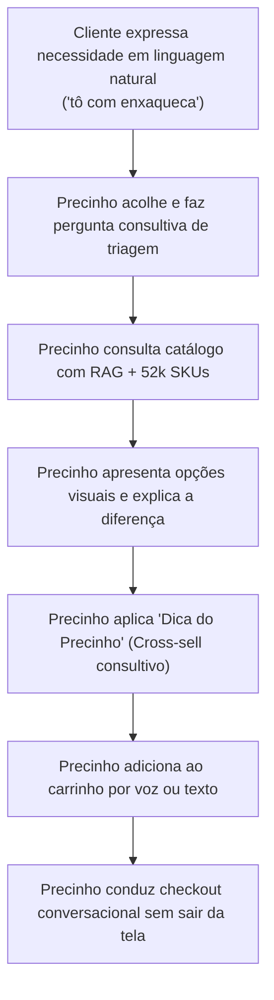

# Capítulo 1: Visão Executiva e Modelo de Negócio

> **Tempo estimado de leitura:** 15 minutos  
> **Objetivo:** Compreender a dor de mercado da Pague Menos, a proposta de valor do comércio agêntico, as alavancas de faturamento e as barreiras regulatórias.

---

## 1. O Problema: A Frieza do E-commerce Tradicional de Farmácia

No varejo farmacêutico físico, o **atendente de balcão** é o maior motor de vendas e retenção. Quando um cliente entra na loja dizendo *"estou com um desconforto no estômago"*, o atendente:
1. Faz perguntas para entender o contexto (há quanto tempo começou, se tomou algo que caiu mal);
2. Apresenta o remédio indicado para o alívio;
3. Sugere itens preventivos ou complementares (ex: um reidratante ou chá digestivo);
4. Constrói um vínculo de confiança.

Em contrapartida, os e-commerces e apps tradicionais são **frios, burocráticos e passivos**:
- Exigem que o cliente saiba exatamente o princípio ativo ou o nome comercial do remédio;
- Falhas de digitação resultam em *"Nenhum produto encontrado"*;
- Não há acolhimento para sintomas ou linguagem coloquial (*"tô com a cabeça latejando"*);
- O abandono de carrinho gira em torno de **70% a 80%**;
- A compra é estritamente transacional, destruindo a margem e o LTV (*Lifetime Value*).

---

## 2. A Solução: O Precinho e o Comércio Agêntico

O **Precinho** foi idealizado para ser o **melhor atendente de balcão da Pague Menos**, disponível 24 horas por dia em qualquer dispositivo (web e smartphone).

Ele transforma a jornada de compra de uma **busca passiva em uma conversa resolutiva**:

---

## 3. As Alavancas de Negócio para a Pague Menos

O impacto financeiro do Precinho na operação da Pague Menos se ancora em 4 indicadores centrais:

### 3.1. Expansão do Ticket Médio (AOV - Average Order Value)
- **Mecanismo:** A *"Dica do Precinho"*.
- **Como funciona:** Sempre que o cliente seleciona um item principal, o agente avalia regras clínicas e comportamentais seguras para sugerir um complemento natural:
  - Comprou protetor solar? -> *"Dica do Precinho: Um gel pós-sol ou hidratante com vitamina C potencializa a proteção da sua pele."*
  - Comprou antibiótico com receita? -> *"Dica do Precinho: Um repositor de flora intestinal (probiótico) previne desconfortos durante o tratamento."*
- **Impacto estimado:** Aumento de **18% a 25% no valor médio da cesta**.

### 3.2. Redução Drástica do Abandono de Carrinho
- No fluxo tradicional, o usuário clica em múltiplos botões, navega por telas de frete confusas e desiste.
- No Precinho, o checkout acontece **inline dentro da própria conversa**:
  - *"Quer retirar na loja perto de você ou receber express em casa?"*
  - *"Prefere pagar no Pix ou Cartão?"*
  - O pedido é fechado em 2 mensagens.

### 3.3. Adesão a Tratamentos Contínuos e Recompra (LTV)
- O Precinho armazena o histórico de pedidos e preferências do cliente.
- Clientes com doenças crônicas (hipertensão, diabetes) recebem atendimento personalizado e lembretes para reabastecimento de receitas e kits mensais.

### 3.4. Venda de Kits Dinâmicos Inteligentes
- O catálogo conta com mais de **570 kits pré-computados** e a capacidade do agente montar **kits sob medida em tempo real** (ex: *Kit Viagem Prático*, *Kit Skincare Essencial*).
- O cliente compra 3 ou 4 produtos complementares com desconto em apenas 1 clique.

---

## 4. Persona do Precinho: Tom Caloroso e Humano

Diferente de assistentes corporativos robóticos, a persona do Precinho foi calibrada para refletir o DNA acolhedor da Pague Menos:

| O que o Precinho É | O que o Precinho NÃO É |
| :--- | :--- |
| Simpático, acolhedor e atencioso | Robótico, professoral ou impessoal |
| Conciso (no máximo 3 a 4 frases por resposta) | Prolixo ou gerador de listas quilométricas |
| Consultor que ouve antes de empurrar produtos | Vendedor agressivo ou insistente |
| Transparente (preços e detalhes nos cards visuais) | Exibidor de tabelas confusas em texto |
| Empático com dores e queixas | Diagnosticador médico ou prescritor |

---

## 5. Compliance, Anvisa e Guardrails de Segurança

Uma farmácia lida com saúde pública e vidas humanas. O Precinho possui **guardrails rígidos** em código e prompt para garantir total conformidade legal:

1. **Nunca faz diagnósticos médicos:**
   - Se o cliente descreve sintomas agudos (*"dor no peito irradiando para o braço"*, *"sangramento intenso"*), o Precinho imediatamente acolhe e orienta a procurar atendimento médico de urgência.
2. **Medicamentos sob Prescrição (Tarja Vermelha / Preta):**
   - Produtos controlados exigem upload e verificação de receita médica válida via endpoint seguro. O checkout é bloqueado se a receita não estiver validada.
3. **MIPs (Medicamentos Isentos de Prescrição):**
   - O Precinho atua como orientador de balcão (balconista / farmacêutico orientador), respeitando dosagens máximas e faixas etárias.
4. **Prevenção de Interações Medicamentosas:**
   - Se o usuário informar alergias (ex: ácido acetilsalicílico) no perfil, o motor de busca filtra automaticamente medicamentos contraindicados.

---

## 📌 Principais Aprendizados do Capítulo 1

- O Precinho é um **agente de comércio transacional e consultivo**, não um assistente genérico.
- Ele ataca as duas maiores dores do e-commerce farmacêutico: **abandono de carrinho** e **frieza no atendimento**.
- Aumenta o Ticket Médio através de **cross-sell consultivo ético ("Dica do Precinho")** e **kits dinâmicos**.
- Opera em total conformidade com a Anvisa, sem jamais emitir diagnósticos médicos.

---

👉 **Siga para o [Capítulo 2: Arquitetura Geral e Fluxo de Dados](./02-arquitetura-geral-e-fluxo-de-dados.md)**
