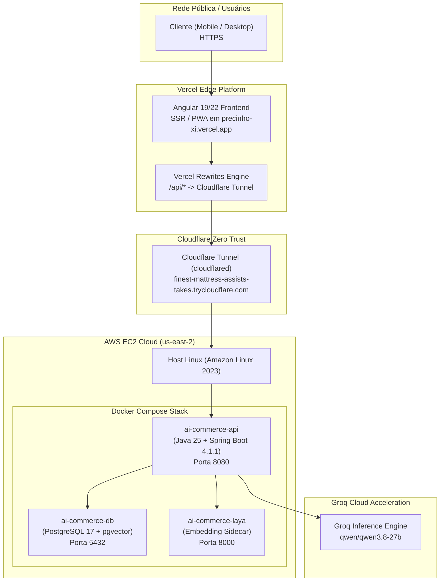
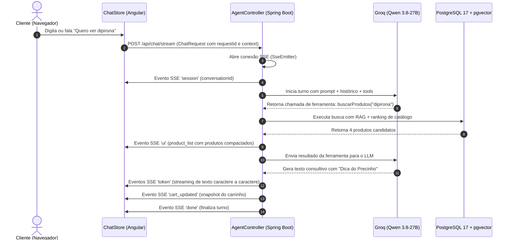

# Capítulo 2: Arquitetura Geral e Fluxo de Dados

> **Tempo estimado de leitura:** 20 minutos  
> **Objetivo:** Compreender a topologia de infraestrutura em nuvem, a integração entre Vercel, Cloudflare e AWS EC2, e o funcionamento dos protocolos UCP, ACP e streaming SSE.

---

## 1. Visão Geral da Topologia em Nuvem

A arquitetura do Precinho foi projetada para combinar **alta performance no Edge** com **isolamento e segurança de dados no backend**:



---

## 2. Componentes da Arquitetura

### 2.1. Frontend Edge (Vercel)
- **Hospedagem:** Vercel Global Edge Network.
- **Domínio de Produção:** `https://precinho-xi.vercel.app/chat`.
- **Papel:** Renderização rápida da interface Angular (Zoneless + Signals), gerenciamento do estado reativo do chat via `ChatStore`, controle de áudio/voz e reprodução de animações e cards visuais.
- **Proxy Transparente (`vercel.json`):**
  Para evitar complexidades de CORS e garantir conexões seguras sob o mesmo domínio, o arquivo `vercel.json` encaminha todas as chamadas para o backend através de regras de rewrite:
  ```json
  {
    "rewrites": [
      { "source": "/api/:path*", "destination": "https://finest-mattress-assists-takes.trycloudflare.com/api/:path*" },
      { "source": "/ucp/:path*", "destination": "https://finest-mattress-assists-takes.trycloudflare.com/ucp/:path*" },
      { "source": "/acp/:path*", "destination": "https://finest-mattress-assists-takes.trycloudflare.com/acp/:path*" }
    ]
  }
  ```

### 2.2. Camada de Conectividade Segura (Cloudflare Zero Trust Tunnel)
- O backend está hospedado em uma instância EC2 sem portas de aplicação (8080 ou 5432) expostas à internet pública.
- Um daemon `cloudflared` roda como serviço nativo `systemd` (`precinho-tunnel.service`) na VM.
- Ele estabelece quatro túneis criptografados de saída (*outbound*) para a rede de borda da Cloudflare.
- **Benefício:** Proteção contra ataques DDoS, isolamento de rede e TLS 1.3 automático de ponta a ponta.

### 2.3. Backend Transacional e Agêntico (AWS EC2)
- **Instância:** AWS EC2 t3/t4 em `us-east-2`.
- **Runtime:** Java 25 com Spring Boot 4.1.1 rodando em contêiner Docker oficial `eclipse-temurin:25-jre`.
- **Concorrência:** Virtual Threads (Project Loom) habilitadas via `Executors.newVirtualThreadPerTaskExecutor()`. Cada requisição SSE roda em uma virtual thread leve, permitindo que a aplicação suporte milhares de conexões streaming simultâneas com baixo consumo de memória.

### 2.4. Banco de Dados Vetorial e Relacional (PostgreSQL 17 + pgvector)
- Imagem: `pgvector/pgvector:pg17`.
- Armazena tabelas relacionais de clientes, carrinhos, linhas de itens, pedidos e receitas.
- Armazena embeddings de 52.441 produtos e 570 kits para recuperação rápida por similaridade semântica.

---

## 3. Protocolos de Comunicação: UCP e ACP

O Precinho implementa dois padrões abertos de comércio inteligente:



### 3.1. Universal Commerce Protocol (UCP)
- Padroniza as estruturas de dados de **Catálogo**, **Carrinho** e **Checkout**.
- Garante que atributos essenciais de varejo farmacêutico (Preço em centavos, Estoque em unidades, Tarja Sanitária, Necessidade de Receita Médica e Dosagem) sejam consumidos de maneira uniforme tanto pelo frontend quanto pelo agente.

### 3.2. Agentic Commerce Protocol (ACP)
- Define a gramática de intenções do agente:
  - *Query Intent*: Intenção de pesquisa/descoberta;
  - *Consultation Intent*: Intenção de esclarecimento de sintomas;
  - *Mutation Intent*: Ação no estado do cliente (adicionar/remover do carrinho);
  - *Transaction Intent*: Fechamento financeiro de pedido.

---

## 4. O Ciclo do Streaming SSE (Server-Sent Events)

O endpoint principal do assistente é o `POST /api/chat/stream`, produzindo `text/event-stream`.

### Tipos de Eventos Empurrados pelo Backend:

| Nome do Evento | Conteúdo dos Dados | Finalidade |
| :--- | :--- | :--- |
| `session` | `{"conversationId": "uuid"}` | Identifica a conversa para persistência de memória. |
| `token` | `{"texto": "..."}` | Pedaços de texto emitidos pelo LLM exibidos progressivamente. |
| `ui` | `{"type": "product_list", "products": [...]}` | Ordena a renderização de cards interativos de produtos. |
| `cart_updated` | `{"carrinho": {"version": 1, "lines": [...]}}` | Atualiza em tempo real o contador e drawer do carrinho. |
| `checkout_updated` | `{"session": {"id": "...", "status": "..."}}` | Atualiza o status do wizard de checkout na conversa. |
| `tool-start` / `tool-end` | `{"id": "...", "label": "Consultando produtos"}` | Informa na tela que o agente está realizando uma consulta. |
| `: heartbeat` | Comentário SSE a cada 15s | Mantém túneis e proxies HTTP abertos sem timeout. |
| `done` | `{"conversationId": "uuid"}` | Sinaliza ao frontend que o processamento do turno concluiu. |

---

## 5. Política de CORS e Segurança em Camadas

Para proteger as APIs contra abusos de terceiros sem quebrar o frontend legítimo:
1. **Origens Permitidas:**
   Configuradas em `SecurityConfig.java` e no `.env` do backend:
   - `https://precinho-xi.vercel.app` (Produção oficial)
   - `http://localhost:4200` e `http://localhost:4000` (Desenvolvimento local)
2. **Métodos Permitidos:** `GET`, `POST`, `PUT`, `DELETE`, `OPTIONS`.
3. **Preflight Automatizado:** Responde imediatamente `HTTP 200` com `Access-Control-Max-Age: 3600` para requisições `OPTIONS` legítimas.
4. **Isolamento de Origem Indevida:** Qualquer origem não autorizada que tente bater no túnel da Cloudflare recebe `HTTP 403 Forbidden`.

---

## 📌 Principais Aprendizados do Capítulo 2

- A arquitetura une **Vercel no Edge**, **Cloudflare Zero Trust** e **AWS EC2**, garantindo segurança sem abrir portas públicas.
- O protocolo de comunicação é **híbrido**: texto é transmitido via tokens SSE progressivos enquanto componentes de UI (produtos, kits, checkout) são transmitidos como eventos estruturados.
- O Spring Boot 4 com Java 25 Virtual Threads permite escalabilidade horizontal leve para suportar conexões persistentes de streaming com custo mínimo de CPU/RAM.

---

👉 **Siga para o [Capítulo 3: Inteligência Artificial e Motor Agêntico](./03-inteligencia-artificial-e-motor-agentico.md)**
