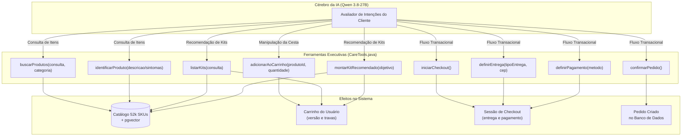

# Capítulo 3: Inteligência Artificial e Motor Agêntico

> **Tempo estimado de leitura:** 25 minutos  
> **Objetivo:** Dominar a integração com o Groq LPU, o modelo Qwen 3.8-27B, o loop de chamada de ferramentas (CareTools), a resolução inteligente de ordinais e as técnicas de resiliência a rate limits e alucinações.

---

## 1. O Motor de Inferência: Groq LPU + Qwen 3.8-27B

Uma experiência conversacional no e-commerce só engaja se for **instantânea**. Se o usuário esperar 5 ou 8 segundos por uma resposta, ele fecha a aba.

Por esse motivo, o Precinho utiliza a infraestrutura **Groq LPU (Language Processing Unit)** combinada ao modelo open-weights **Qwen 3.8-27B**:

### Por que essa combinação é imbatível?
1. **Velocidade Extrema (Time-to-First-Token < 250ms):**
   - O Groq processa tokens em circuitos ASIC de memória estática de altíssima largura de banda (SRAM), gerando mais de **250 a 400 tokens por segundo**.
   - A resposta começa a fluir na tela do usuário praticamente no momento em que ele termina de falar ou digitar.
2. **Capacidade Multilíngue e Português pt-BR Nativo:**
   - O Qwen 3.8 possui treinamento massivo em línguas românicas, gerando diálogos em português natural com concordância perfeita, gírias farmacêuticas (*"blister"*, *"drágea"*, *"gotas"*) e acolhimento cultural.
3. **Tool Calling Confiável (Chamada de Funções):**
   - O modelo respeita com precisão esquemas JSON estritos, gerando chamadas de função com parâmetros limpos e sem quebra de sintaxe.

---

## 2. Anatomia das Ferramentas do Agente (`CareTools`)

O modelo não tem acesso direto ao banco de dados; ele atua através de um conjunto rigoroso de **9 ferramentas de balcão**:



### Detalhamento das Ferramentas Principais:

1. **`buscarProdutos(consulta)`**:
   - Usado quando o usuário cita um nome ou categoria específica (*"tem Neosaldina?"*, *"protetor solar fator 50"*).
   - Realiza busca ponderada por relevância, marca e preço. Emite o evento `ui: product_list`.
2. **`identificarProduto(descricao)`**:
   - Usado quando o cliente relata sintomas ou queixas (*"estou com uma cólica muito forte"*, *"azia depois do almoço"*).
   - Aciona o motor de resolução sintomática e recupera os medicamentos recomendados com indicação terapêutica.
3. **`adicionarAoCarrinho(produtoId, quantidade)`**:
   - Usado sempre que o cliente indica querer comprar um item (*"adiciona o primeiro"*, *"quero levar a neosaldina"*, *"coloca 2 no carrinho"*).
   - Atualiza atomicamente a tabela de carrinhos e emite o evento `cart_updated`.
4. **`iniciarCheckout()`**:
   - Transforma a intenção de compra em uma transação financeira ativa.
   - Avalia bloqueios de segurança (ex: se há produto controlado sem receita validada) e calcula subtotais e taxas de entrega.
5. **`definirEntrega(tipoEntrega, cep)`**:
   - Define entre `pickup` (retirada gratuita na loja física mais próxima) ou `delivery` (entrega expressa em domicílio).
6. **`definirPagamento(metodoPagamento)`**:
   - Define a modalidade: `pix`, `card` (cartão de crédito) ou `pickup` (pagamento presencial no balcão).
7. **`confirmarPedido()`**:
   - Conclui a ordem, limpa a sessão ativa de carrinho e gera o identificador oficial do pedido rastreável.

---

## 3. Resolução Inteligente de Produtos e Seleção Ordinal

Um dos maiores desafios em comércio agêntico conversacional é o usuário se referir a produtos de forma indireta:
- *"Adiciona o primeiro no meu carrinho"*
- *"Quero a segunda opção"*
- *"Coloca essa Neosaldina"*

### Como o Precinho Resolve isso de Forma 100% Confiável:
O `LlmClientService` implementa um cache em memória concorrente (`recentCandidatesByConversation`) sincronizado por ID de conversa:
1. Quando o agente executa `buscarProdutos` ou `identificarProduto`, os 4 produtos exibidos são armazenados no cache da sessão.
2. Quando o usuário pede *"adiciona o primeiro"* ou *"opcao 1"*:
   - O método `resolveProductTarget` intercepta a expressão ordinal via regex:
     ```java
     if (clean.matches(".*(primeir|1|opcao 1|opção 1).*") && recent != null && !recent.isEmpty()) {
       return recent.get(0); // Pega o primeiro card exibido
     }
     ```
3. O ID exato do produto (ex: `159558`) é resolvido no catálogo oficial e inserido no carrinho em milissegundos.
4. **Resultado:** Zero falhas de "produto não encontrado" quando o cliente usa ordinais normais de fala.

---

## 4. Otimização de Tokens e Blindagem contra Rate Limits (7.000 ITPM)

Na camada de nuvem da Groq, o modelo Qwen 3.8 opera com um limite de taxa no plano gratuito de **7.000 Input Tokens Per Minute (ITPM)**.

### A Estratégia de Economia de Tokens do Precinho:
Se cada chamada enviasse o histórico completo e descrições prolixas, uma conversa de 4 turnos consumiria mais de 8.000 tokens e dispararia o erro `HTTP 429 Rate Limit`.

Para garantir operação contínua e estável:
1. **System Prompt Enxuto e Denso:**
   - Reduzido de 96 linhas para 22 linhas altamente focadas em instruções de ação.
   - Consumo de tokens do prompt do sistema caiu de **520 para 165 tokens**.
2. **Janela Deslizante de Memória (Compact History):**
   - Em vez de retransmitir 5 ou 6 turnos antigos do banco de dados, o serviço recupera apenas a **última interação (1 pergunta do usuário e 1 resposta do assistente)**.
   - Textos de assistente com mais de 180 caracteres são truncados no histórico.
   - Economia de mais de **1.000 tokens por requisição**.
3. **Esquema de Ferramentas Compacto:**
   - Definições JSON enxutas com parâmetros estritamente necessários.
4. **Pool de Chaves Multi-Key com Round-Robin e Failover Instantâneo (429):**
   - O backend suporta múltiplas chaves de API da Groq (definidas via GROQ_API_KEY=key1,key2 ou GROQ_API_KEY_FALLBACK).
   - **Round-Robin Preventivo:** As chamadas distribuem-se alternadamente entre as chaves do pool, multiplicando a capacidade de tokens/minuto (ex: 2 chaves elevam o teto para 14.000 ITPM).
   - **Failover Instantâneo:** Se uma chave retornar HTTP 429 (Rate Limit) ou erro de cota, a chamada é redirecionada imediatamente para a chave reserva no mesmo instante, com zero atraso perceptível ao usuário.
   - **Backoff de Segurança:** Se todas as chaves do pool estiverem saturadas simultaneamente, o sistema aplica um backoff de 1,5s e reexecuta.

---

## 5. Prevenção de Vazamento de Tags XML e Respostas Vazias

Alguns modelos LLM sob alta carga ou formatos mistos podem ocasionalmente tentar cuspir trechos de marcação técnica no texto, como `<tool_call><function=...>` ou retornar respostas em branco após executar uma ferramenta.

O Precinho possui **dois filtros de proteção ativa em runtime**:

### 5.1. Sanitização de Texto (`emitTokens`):
Antes de empurrar qualquer caractere para o stream SSE, o método faz a limpeza de qualquer resíduo técnico:
```java
String cleaned = fullText
  .replaceAll("<tool_call>[\\s\\S]*?</tool_call>", "")
  .replaceAll("<function=[^>]+>[\\s\\S]*?</function>", "")
  .replaceAll("<parameter=[^>]+>[\\s\\S]*?</parameter>", "")
  .replaceAll("```json[\\s\\S]*?```", "")
  .trim();
```

### 5.2. Síntese Contextual de Contingência (`synthesizeToolFeedback`):
Se a segunda chamada do LLM vier vazia após o uso de uma ferramenta, o sistema injeta imediatamente uma resposta natural e carinhosa correspondente à ação realizada:
- **Ao adicionar no carrinho:** *"Prontinho! Adicionei ao seu carrinho com sucesso. 🛒 Você gostaria de ver mais alguma opção ou prefere ir para o checkout?"*
- **Ao iniciar checkout:** *"Iniciei o seu checkout! 🛒 Você prefere retirar grátis em uma farmácia Pague Menos ou receber em casa por entrega expressa?"*
- **Ao confirmar pedido:** *"🎉 Parabéns! Seu pedido foi confirmado com sucesso na Pague Menos! Você pode acompanhar o status por aqui a qualquer momento."*

O usuário **nunca recebe um balão vazio ou uma mensagem quebrada**.

---

## 📌 Principais Aprendizados do Capítulo 3

- A inferência com **Groq LPU** garante latência imperceptível (<0.5s), transformando a conversa em um diálogo natural.
- As ferramentas (**CareTools**) dão ao modelo capacidade transacional real (carrinho, checkout, estoque e catálogo).
- A **resolução ordinal** permite comandos naturais como *"adiciona o primeiro"*.
- A arquitetura é **blindada contra limites de taxa e vazamento de código técnico**, operando com alta resiliência em produção.

---

👉 **Siga para o [Capítulo 4: Backend Spring Boot 4 e Java 25](./04-backend-spring-boot-4-e-java-25.md)**
