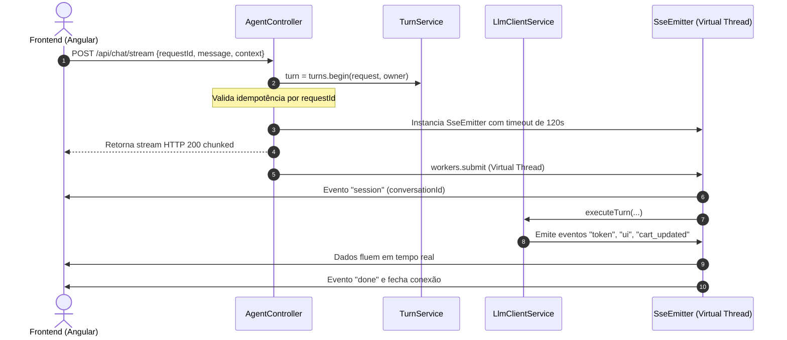
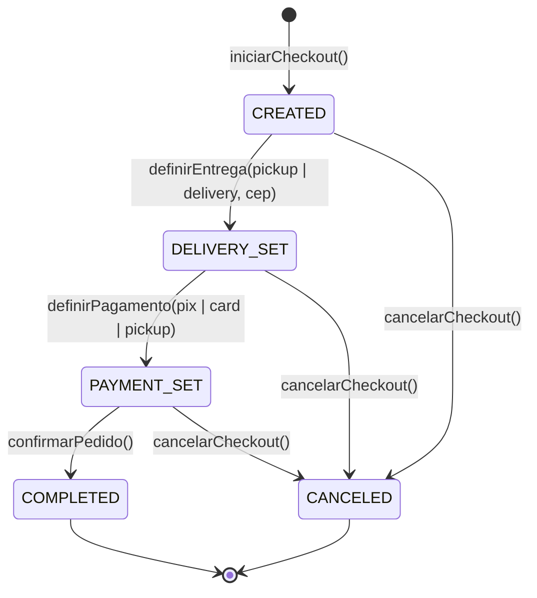

# Capítulo 4: Backend Spring Boot 4 e Java 25

> **Tempo estimado de leitura:** 20 minutos  
> **Objetivo:** Compreender a organização interna do backend, o uso de Java 25 com Virtual Threads, a arquitetura de controllers e services, a gestão atômica de carrinhos e o modelo de segurança.

---

## 1. Stack Tecnológica e Recursos Modernos do Java 25

O backend do Precinho foi construído sobre a versão mais recente do ecossistema corporativo Java:

- **Java Runtime:** Eclipse Temurin OpenJDK 25 (LTS moderno).
- **Framework:** Spring Boot 4.1.1 + Spring Framework 7.
- **Concorrência:** **Project Loom (Virtual Threads)** habilitado nativamente.
  - No modelo tradicional (*thread-per-request*), conexões persistentes de streaming SSE consumiam uma thread do sistema operacional (OS thread de 1MB de stack) cada, limitando a máquina a poucas centenas de conexões.
  - Com Virtual Threads, cada requisição SSE consome apenas uma fração de kilobyte de heap, permitindo que a mesma instância EC2 atenda a **mais de 10.000 conexões simultâneas de streaming** sem degradação.
- **Segurança de Tipos:** Registros Java (`record`) imutáveis para DTOs, requisições e eventos.
- **Criptografia:** Argon2id para hash de senhas de clientes no padrão OWASP.

---

## 2. Estrutura de Pacotes do Projeto

O código-fonte está localizado sob o pacote raiz `com.igaratech.aicommerce.care`:

```
com.igaratech.aicommerce.care
├── ai/
│   ├── CareTools.java             <- Definição de anotações @Tool e ações executivas
│   ├── GroqClientService.java     <- Subclasse de compatibilidade delegando ao LlmClientService
│   ├── LlmClientService.java      <- Motor agêntico Groq/OpenAI, tool calling e retries
│   ├── ProductResolver.java       <- Interface de resolução semântica de produtos
│   ├── HybridProductResolver.java <- Resolução combinada (texto + embeddings pgvector)
│   └── ProductionGuard.java       <- Guardrails clínicos e prevenção de riscos Anvisa
├── config/
│   ├── AgentConfig.java           <- Configuração de beans de IA e memória
│   ├── SecurityConfig.java        <- Filtros de CORS, rotas públicas e proteção CSRF
│   └── VectorConfig.java          <- DataSource e extensões pgvector
├── controller/
│   ├── AgentController.java       <- Endpoint SSE /api/chat/stream e orquestração de turnos
│   ├── CatalogController.java     <- Endpoints REST de busca e listagem de catálogo
│   ├── CartCommands.java          <- Mutações síncronas de carrinho
│   ├── CheckoutSessionController.java <- Endpoints REST de sessões de pagamento
│   └── AuthController.java        <- Registro, login e validação de tokens
├── service/
│   ├── CartService.java           <- Lógica de negócio do carrinho e bloqueios sanitários
│   ├── CatalogService.java        <- Consultas otimizadas e criação de kits customizados
│   ├── CheckoutSessionService.java<- Máquina de estados do checkout (pickup/delivery/pix)
│   ├── TurnService.java           <- Idempotência, atomicidade e histórico de turnos
│   └── PrescriptionService.java   <- Verificação e validação de receitas médicas
└── model/
    ├── Models.java                <- Records centrais: Product, Kit, Cart, CartLine, Event
    └── CheckoutSession.java       <- Entidade de checkout e opções de frete/pagamento
```

---

## 3. O Fluxo de Execução do `AgentController`

O `AgentController` é a porta de entrada para a experiência conversacional. Vamos analisar os pontos-chave de sua implementação:



### 3.1. Garantia de Idempotência e Conexões Resilientes:
- Cada requisição carrega um `requestId` único (UUID) gerado pelo cliente.
- Se o usuário sofrer uma oscilação de 4G no meio do turno e reconectar com o mesmo `requestId`, o método `turn.fresh()` detecta a duplicidade e executa o `turn.replay()`, devolvendo os eventos já processados sem cobrar novo custo de IA ou duplicar itens no carrinho.
- Um *heartbeat* em segundo plano a cada 15 segundos (`emitter.send(comment("heartbeat"))`) impede que proxies ou conexões móveis caiam por inatividade durante pausas de digitação.

---

## 4. O `CartService`: Controle Estrito de Estado e Travas Sanitárias

Diferente de e-commerces comuns onde o frontend calcula totais e pode ser manipulado, no Precinho **toda a regra de preços, descontos e travas de segurança é calculada com autoridade no servidor**:

### 4.1. Versão do Carrinho (`version`):
- O carrinho possui um contador monotônico `version`.
- Cada adição, remoção ou alteração de quantidade incrementa essa versão.
- O frontend compara a versão local com o evento `cart_updated` recebido via SSE para garantir que a interface reflita o estado exato do banco de dados sem condições de corrida (*race conditions*).

### 4.2. Bloqueadores de Checkout (`blockers`):
O método `checkoutAllowed()` retorna `false` caso haja qualquer pendência impeditiva:
- Se o carrinho contiver um produto de tarja vermelha/preta e a receita médica anexada não tiver o status `APPROVED`;
- Se o carrinho estiver vazio;
- Se a quantidade de algum item exceder o estoque disponível.

---

## 5. Máquina de Estados do Checkout (`CheckoutSessionService`)

O checkout conversacional segue uma máquina de estados linear e à prova de falhas:



1. **Estado `CREATED`:**
   - Cria uma sessão vinculada ao `conversationId` e `owner`.
   - Congela o subtotal do carrinho.
2. **Estado `DELIVERY_SET`:**
   - Se `pickup`: Frete R$ 0,00 e vincula à loja Pague Menos mais próxima.
   - Se `delivery`: Valida o CEP informado e calcula a taxa expressa (padrão R$ 8,90).
3. **Estado `PAYMENT_SET`:**
   - Registra o método escolhido (`pix`, `card`, `pickup`).
   - Prepara os dados para cobrança (QR Code Pix ou formulário de cartão seguro).
4. **Estado `COMPLETED`:**
   - Gera o registro na tabela `pedidos`, esvazia o carrinho ativo e dispara a notificação de sucesso com o código de rastreamento.

---

## 📌 Principais Aprendizados do Capítulo 4

- O backend aproveita as **Virtual Threads do Java 25** para suportar streaming massivo com footprint de memória levíssimo.
- O `AgentController` e o `TurnService` implementam **idempotência nativa**, eliminando riscos de cobrança duplicada em caso de reconexão.
- As regras de negócio e travas de segurança sanitária da Anvisa residem estritamente no **CartService**, blindadas contra manipulações de cliente.
- A máquina de estados do checkout permite que a transação inteira ocorra de forma conversacional ou via interface gráfica com perfeita sincronia.

---

👉 **Siga para o [Capítulo 5: Banco de Dados e Catálogo de Produtos](./05-banco-de-dados-e-catalogo-de-produtos.md)**
