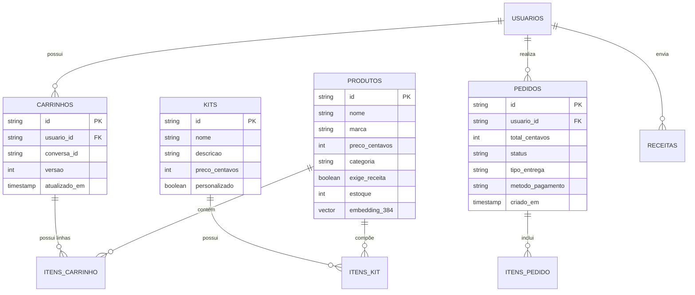

# Capítulo 5: Banco de Dados e Catálogo de Produtos

> **Tempo estimado de leitura:** 15 minutos  
> **Objetivo:** Compreender a estrutura do PostgreSQL 17 com pgvector, a modelagem de dados do comércio agêntico, a gestão do catálogo real de 52.441 SKUs e o algoritmo de kits promocionais.

---

## 1. O Banco de Dados: PostgreSQL 17 + pgvector

Para atender à demanda híbrida do Precinho (consultas relacionais ACID para carrinhos e pedidos + buscas vetoriais semânticas para busca por sintomas), a arquitetura adota o **PostgreSQL 17** com a extensão **pgvector**:



---

## 2. O Catálogo Real da Pague Menos (52.441 SKUs)

O banco de produção do Precinho foi populado a partir do dump oficial da Pague Menos contendo **52.441 produtos ativos**, abrangendo:
- **Medicamentos MIP (Isentos de Prescrição):** Analgésicos, antitérmicos, antiácidos, antialérgicos, antigripais.
- **Medicamentos Tarjados:** Antibióticos, anti-hipertensivos, antidepressivos (com trava obrigatória de validação de receita).
- **Dermocosméticos & Skincare:** Protetores solares, hidratantes faciais, séruns, sabonetes dermatológicos (Nivea, La Roche-Posay, Vichy, CeraVe).
- **Higiene & Cuidados Pessoais:** Shampoos, desodorantes, cremes dentais, fraldas infantis e geriátricas.
- **Suplementação & Vitaminas:** Whey protein, creatina, ômega 3, multivitamínicos, colágeno.

### Atributos Críticos de Cada Produto:
- `id`: Código numérico SKU único (ex: `159558`);
- `name`: Nome comercial completo com dosagem e apresentação (ex: *"Neosaldina Muscular Dipirona 300mg + Cafeína 50mg 10 Drágeas"*);
- `price`: Armazenado em **centavos inteiros** (ex: `699` para R$ 6,99), eliminando erros de arredondamento de ponto flutuante (*floating point*);
- `requires_prescription`: Booleano que aciona o guardrail de bloqueio de checkout caso `true`;
- `stock`: Quantidade em estoque atualizada em tempo real;
- `dosage`: Dosagem padronizada (ex: *"500mg"*, *"1g"*, *"gotas"*).

---

## 3. Busca Semântica Vetorial (RAG com pgvector)

Quando o usuário pesquisa por termos literais (*"dipirona 500mg"*), uma busca full-text tradicional funciona bem. No entanto, quando ele relata um sintoma ou necessidade (*"algo pra aliviar queimação na garganta e estômago"*), buscas por palavras-chave exatas falham.

### Como a Busca Vetorial Funciona:
1. Cada produto e categoria possui um vetor de embedding gerado pelo modelo semântico;
2. A consulta do cliente é transformada em um vetor de dimensão similar;
3. O PostgreSQL executa o cálculo da **distância de cosseno** via operador `<=>`:
   ```sql
   SELECT id, nome, preco_centavos, (embedding <=> :query_vector) AS distancia
   FROM produtos
   WHERE estoque > 0
   ORDER BY distancia ASC
   LIMIT 4;
   ```
4. Os 4 produtos mais semanticamente alinhados à queixa do usuário são retornados em menos de 15ms.

---

## 4. O Sistema de Kits: Catálogo Pronto + Montagem Dinâmica

O Precinho possui duas modalidades de kits:

### 4.1. Kits Pré-Computados do Catálogo (570 Kits):
Combos de alta demanda montados pelo time comercial da Pague Menos:
- *Kit Proteção Diária* (Protetor Solar + Gel Hidratante + Sabonete Facial);
- *Combo Família* (2x Fraldas Pampers + Lenços Umedecidos);
- *Kit Imunidade Forte* (Vitamina C + Zinco + Própolis).

### 4.2. Kits Customizados Dinâmicos (`montarKitRecomendado`):
Quando o cliente pede algo sob medida (*"vou viajar para a praia no fim de semana, o que eu levo?"*):
1. O agente identifica os itens essenciais para a viagem (protetor solar corporal, protetor labial, repelente e hidratante pós-sol);
2. Invoca a ferramenta `montarKitRecomendado`;
3. O `CatalogService` cria uma nova entidade `Kit` no banco de dados, gera um `kitId` único e aplica um desconto promocional de combo;
4. O kit é devolvido na conversa como um card interativo com botão *"Adicionar Kit ao Carrinho"*, permitindo a compra de todos os itens com 1 toque.

---

## 📌 Principais Aprendizados do Capítulo 5

- O banco utiliza **PostgreSQL 17 + pgvector**, permitindo tanto consistência transacional ACID quanto busca semântica inteligente de alta velocidade.
- O catálogo real conta com **52.441 SKUs**, com preços em centavos e flags regulatórias de prescrição.
- A busca por sintomas utiliza **similaridade de cosseno via embeddings**, compreendendo queixas em linguagem coloquial.
- O sistema de kits combina **570 combos pré-existentes** com a capacidade única de **gerar kits personalizados sob medida** salvos no catálogo em tempo real.

---

👉 **Siga para o [Capítulo 6: Frontend Angular, Signals e UX](./06-frontend-angular-signals-e-ux.md)**
