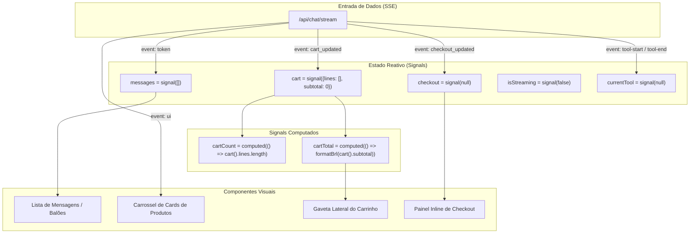

# Capítulo 6: Frontend Angular, Signals e UX

> **Tempo estimado de leitura:** 15 minutos  
> **Objetivo:** Compreender a arquitetura reativa do frontend Angular (Zoneless + Signals), o gerenciamento de estado do `ChatStore`, o consumo de Server-Sent Events e a integração de acessibilidade.

---

## 1. Stack do Frontend: Angular Moderno Zoneless

O frontend do Precinho foi desenvolvido utilizando a versão mais recente do framework corporativo da Google:

- **Framework:** Angular 19/22 com modo **Zoneless** ativado (`provideExperimentalZonelessChangeDetection()`).
  - O antigo `zone.js` interceptava todas as operações assíncronas do navegador, causando ciclos desnecessários de verificação de mudanças globais (*change detection*).
  - O modo Zoneless com **Signals** atualiza cirurgicamente apenas os elementos do DOM afetados, garantindo 60fps constantes mesmo durante streaming intenso de tokens.
- **Gestão de Estado:** `ChatStore` baseado em Signals primitivos (`signal()`, `computed()`).
- **Renderização:** SSR (*Server-Side Rendering*) e Hydration para carregamento inicial em alta velocidade, além de suporte offline com Service Workers (PWA).
- **Estilização:** SCSS modular, design system alinhado à identidade visual da Pague Menos (Azul Royal `#002B7F`, Vermelho `#E30613`, Branco e cinzas neutros).

---

## 2. Arquitetura do `ChatStore`: O Coração da Interface

O `ChatStore` é o serviço singleton responsável por manter o estado da experiência conversacional:



---

## 3. Consumo e Despacho de Eventos SSE (`chat-transport.ts`)

O transporte HTTP utiliza a API `fetch` com leitura por chunks de `ReadableStream`:

```typescript
// Exemplo conceitual do parser de SSE no ChatTransport
const response = await fetch('/api/chat/stream', {
  method: 'POST',
  headers: { 'Content-Type': 'application/json', 'Accept': 'text/event-stream' },
  body: JSON.stringify(payload)
});

const reader = response.body.getReader();
const decoder = new TextDecoder();

while (true) {
  const { done, value } = await reader.read();
  if (done) break;
  
  const chunk = decoder.decode(value);
  // Parseia linhas de "event: ..." e "data: ..."
  // Despacha para o ChatStore de acordo com o tipo
}
```

### Comportamento dos Eventos na Interface:
- **`token`**: Adiciona os novos caracteres à última mensagem do tipo `assistant`. O texto parece estar sendo digitado em tempo real por um humano.
- **`ui` (product_list / kit_card)**: Renderiza componentes visuais ricos logo abaixo do balão de texto. O usuário pode clicar em *"Adicionar"* ou ver a imagem e dosagem.
- **`cart_updated`**: Atualiza o ícone do carrinho no cabeçalho e recalcula o total sem piscar a tela.
- **`checkout_updated`**: Abre o painel interativo de finalização de compra, onde o cliente pode alternar entre retirada/entrega ou Pix/Cartão por toque ou continuando a falar.

---

## 4. UI Generativa e Componentes Interativos

O Precinho combina texto com **componentes visuais de ação imediata**:

| Componente | Visual | Interação Possível |
| :--- | :--- | :--- |
| **Product Card** | Foto, nome completo, dosagem, tarja, preço em R$ e selo Pague Menos | Botão "Adicionar ao Carrinho", seletor de quantidade e detalhes de bula |
| **Kit Card** | Lista de produtos do combo, desconto percentual e valor total | Botão "Comprar Kit Completo com 1 Toque" |
| **Checkout Wizard** | Steps visuais: 1. Entrega -> 2. Pagamento -> 3. Confirmação | Seleção de retirada em loja, inserção de CEP e escolha Pix/Cartão |
| **Order Tracking** | Linha do tempo visual com etapas (Confirmado -> Em Separação -> Pronto para Retirada) | Código do pedido e botão de cópia de chave Pix |

---

## 5. Acessibilidade Total: Mahoraga Accessibility Widget

Para garantir que a farmácia atenda a **todos os cidadãos brasileiros**, incluindo pessoas com deficiência visual, auditiva ou motora, a aplicação integra o **Mahoraga Accessibility Suite**:

- **Intérprete de Libras:** Avatar de Língua Brasileira de Sinais para tradução do atendimento farmacêutico;
- **Contraste Dinâmico:** Modos Alto Contraste Preto/Amarelo e Modo Noturno (*Dark Mode*);
- **Leitor de Tela Nativo:** Rótulos `aria-label`, foco semântico em botões e descrição audível de mudanças de carrinho;
- **Ajuste de Escala de Fonte:** Redimensionamento dinâmico sem quebra de layout para idosos ou pessoas com baixa acuidade visual.

---

## 📌 Principais Aprendizados do Capítulo 6

- O frontend adota **Angular 19/22 Zoneless**, proporcionando performance de 60fps sem sobrecarga de *change detection*.
- O **`ChatStore` reativo** sincroniza o estado da conversa, carrinho e checkout de forma instantânea via SSE.
- A experiência mistura **diálogo natural com UI generativa interativa** (cards de produtos, kits e checkout inline).
- A aplicação é totalmente inclusiva, com acessibilidade para Libras, leitores de tela e pessoas da terceira idade.

---

👉 **Siga para o [Capítulo 7: Guia de Deploy, Infraestrutura e Operações](./07-guia-de-deploy-infraestrutura-e-operacoes.md)**
