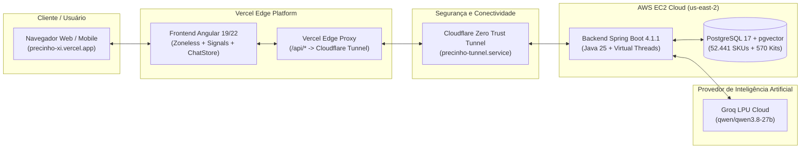

# Precinho: Manual Definitivo e Guia de Domínio em 2 Horas

> **Assistente Virtual e Consultor de Comércio Agêntico da Farmácia Pague Menos**  
> *Desenvolvido com Java 25, Spring Boot 4.1.1, Groq LPU, Qwen 3.8-27B, Angular 19/22 Zoneless e PostgreSQL 17 + pgvector.*

---

## 🎯 Objetivo deste Guia

Este repositório foi construído para que você **compreenda, domine e saiba defender com autoridade 100% da arquitetura, do modelo de negócio e da engenharia do Precinho em até 2 horas de leitura estruturada**.

Seja para uma apresentação executiva, alinhamento técnico com times de engenharia, sabatina de diretoria da Pague Menos ou banca avaliadora da Avanade, cada capítulo entrega a essência prática sem enrolação.

---

## ⏱️ Trilha de Leitura Cronometrada (120 Minutos)

| Tempo | Capítulo | Tema Central | O que você vai dominar |
| :--- | :--- | :--- | :--- |
| **00 - 15 min** | [01 - Visão Executiva e Negócio](./01-visao-executiva-e-modelo-de-negocio.md) | O diferencial Pague Menos | Por que o Precinho aumenta o Ticket Médio (AOV), cesta de compras, compliance Anvisa e persona. |
| **15 - 35 min** | [02 - Arquitetura e Protocolos](./02-arquitetura-geral-e-fluxo-de-dados.md) | Arquitetura End-to-End | Diagramas C4, fluxo de dados, streaming SSE, protocolos UCP/ACP, Cloudflare Tunnel e Vercel. |
| **35 - 60 min** | [03 - Inteligência Artificial e Agentes](./03-inteligencia-artificial-e-motor-agentico.md) | Motor LLM e Tool Calling | Groq LPU, Qwen 3.8-27B, ferramentas CareTools, prevenção de alucinação, resolução ordinal e RAG. |
| **60 - 80 min** | [04 - Backend Spring Boot 4](./04-backend-spring-boot-4-e-java-25.md) | Engenharia Java 25 | Virtual Threads (Loom), controllers, serviços de carrinho e checkout, idempotência e Argon2. |
| **80 - 95 min** | [05 - Banco de Dados e Catálogo](./05-banco-de-dados-e-catalogo-de-produtos.md) | PostgreSQL 17 + pgvector | Catálogo real de 52.441 SKUs, 570 kits, embeddings vetoriais e índices HNSW/IVFFlat. |
| **95 - 110 min** | [06 - Frontend Angular e UX](./06-frontend-angular-signals-e-ux.md) | Angular Zoneless e Signals | ChatStore reativo, eventos SSE em tempo real, UI generativa, acessibilidade e mobile-first. |
| **110 - 120 min** | [07 - Deploy e Operações](./07-guia-de-deploy-infraestrutura-e-operacoes.md) | Nuvem e Produção | AWS EC2, Docker Compose v2, Cloudflare Zero Trust, Vercel proxy e runbooks de suporte. |
| **Bônus / Revisão** | [08 - Roteiro de Pitch e FAQ](./08-roteiro-de-pitch-e-perguntas-respostas.md) | Pitch & Sabatina | Scripts de apresentação (3, 5 e 10 min) e respostas para 15 perguntas difíceis de executivos. |

---

## 💡 O que é o Precinho em 60 Segundos?

O **Precinho** não é um chatbot de FAQ. Ele é uma plataforma de **Comércio Agêntico Conversacional** que reproduz digitalmente a experiência calorosa e resolutiva do atendente de balcão da farmácia Pague Menos:

1. **Acolhe com Empatia**: Se o cliente diz *"estou com dor de cabeça forte"*, o Precinho não joga uma lista fria de remédios; ele faz uma pergunta empática para entender o quadro e histórico de alergias.
2. **Recomenda com Precisão**: Busca no catálogo de **52.441 produtos reais** e sugere a melhor opção terapêutica e custo-benefício.
3. **Expande a Cesta (Dica do Precinho)**: Sugere produtos complementares éticos e não insistentes (ex: protetor gástrico para analgésico de uso contínuo, protetor solar com hidratante facial).
4. **Executa Transações Reais**: Adiciona produtos ao carrinho por comandos naturais (*"adiciona o primeiro"*, *"quero a dipirona"*), inicia o checkout, define retirada ou entrega expressa, configura o método de pagamento (Pix/Cartão) e fecha o pedido na conversa.
5. **Ultra-Rápido e Fluido**: Respostas geradas em menos de 0,5 segundo graças ao hardware dedicado Groq LPU com o modelo open-weights Qwen 3.8-27B.

---

## 🗺️ Mapa de Comunicação e Componentes

---

## 🔑 Glossário Essencial

- **ACP (Agentic Commerce Protocol)**: Protocolo que rege a comunicação entre agentes de IA e motores transacionais de e-commerce.
- **UCP (Universal Commerce Protocol)**: Especificação padronizada para troca de dados de catálogo, preços, estoque e carrinho.
- **SSE (Server-Sent Events)**: Mecanismo de streaming HTTP unidirecional que permite ao backend empurrar tokens de texto e eventos de UI para o frontend em tempo real.
- **pgvector**: Extensão do PostgreSQL que permite armazenar e consultar embeddings vetoriais com busca por similaridade de cosseno em escala de milissegundos.
- **Groq LPU**: *Language Processing Unit*, arquitetura de hardware proprietária da Groq desenhada especificamente para inferência sequencial de LLMs com latência determinística mínima.
- **Signals**: Mecanismo reativo primitivo do Angular que substitui a necessidade do Zone.js, proporcionando renderizações cirúrgicas de alta performance.

---

Comece agora a sua jornada pelo **[Capítulo 1: Visão Executiva e Modelo de Negócio](./01-visao-executiva-e-modelo-de-negocio.md)**!
